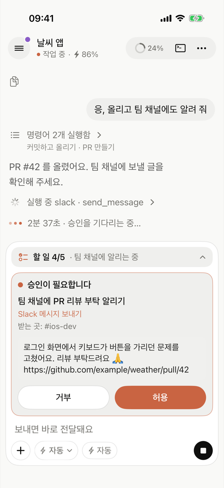
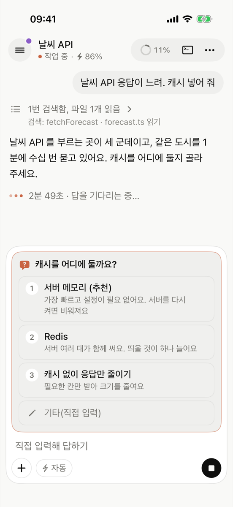
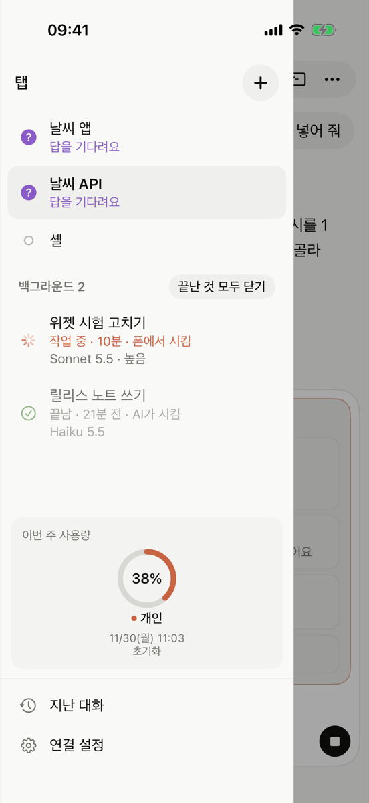
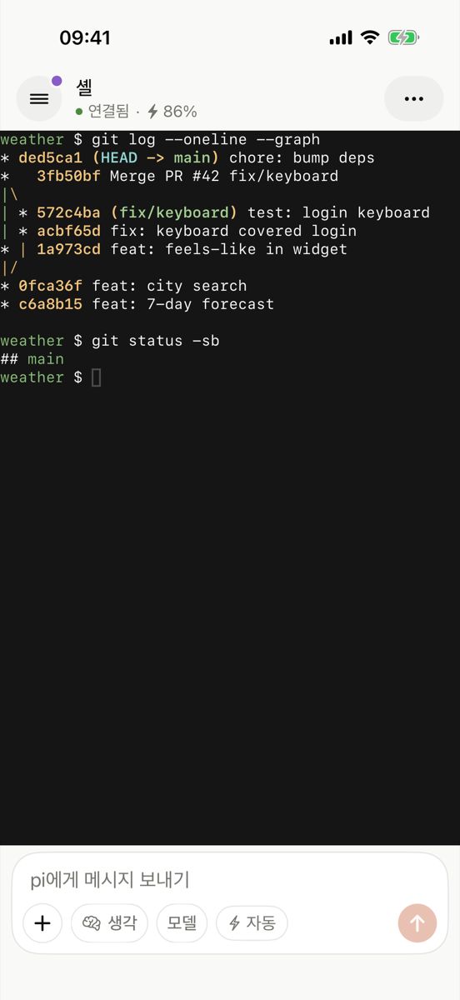

# Antenna

[English](./README.md)

맥에서 돌고 있는 [Claude Code](https://claude.com/claude-code)와 [pi](https://www.npmjs.com/package/@earendil-works/pi-coding-agent) 세션을 아이폰에서 그대로 쓴다. 안드로이드 앱도 있다([안드로이드 앱](./docs/setup.ko.md#안드로이드-앱)).

<p align="center">
  
  
  
  
</p>
<p align="center"><sub>왼쪽부터 Claude Code 탭(보내기 전 승인 카드), pi 탭(고르는 질문), 탭 서랍, 터미널 화면. 화면의 대화는 예시다.</sub></p>

에이전트는 맥의 tmux 안에서 계속 돈다. 아이폰 앱은 tmux 탭마다 채팅 화면(대화, 승인·질문 카드, 할 일 목록)이나 진짜 터미널 화면을 보여 주고, 어느 쪽에서 치든 다른 쪽에 그대로 나타난다. 폰에서는 아무것도 실행되지 않는다. 앱은 맥에 띄운 작은 브리지와 바로 이야기하고, 그 사이에 다른 서버는 없다. 맥에서 밖으로 나가는 것은 사용량 조회(Anthropic)와, 알림을 켰을 때의 알림(Apple 푸시 서버)뿐이다.

> 옛 이름은 pi-remote 다. 식별자는 예전 이름 그대로다: 설정 폴더 `~/.config/pi-remote`, 설정 값 `PI_REMOTE_*`, 링크 `piremote://`.

## 작성자는 이렇게 쓴다

- 맥북에 tmux 세션 하나를 켜 두고, 탭마다 Claude Code·pi 에게 일을 맡긴다.
- 맥 앞을 떠나면 아이폰 앱으로 이어서 본다. 승인이나 질문이 오면 알림을 받고 카드로 답하고, 오래 걸리는 일은 백그라운드 탭으로 보낸다.
- 집 공유기에 VPN 서버(OpenVPN)를 켜 두었다. 맥북은 회사·카페에 들고 나가도 늘 그 VPN 에 붙어 있고, 폰도 밖에서는 그 VPN 에 붙는다. 그래서 폰은 어디서든 맥의 VPN 주소 하나로 붙는다([밖에서 쓰기](#밖에서-쓰기)).
- 같은 Wi-Fi 에서는 VPN 없이 바로 붙는다.

## 되는 일

- **채팅 화면**(Claude Code·pi 탭): 대화, 도구 실행 단계, 그리고 폰에서 바로 답할 수 있는 승인 카드와 고르는 질문 카드. Claude Code 가 훅 없이 키를 기다리는 창(`/exit` 때 보내지 않은 피드백 초안 안내 등)도 맥 화면에서 읽어 카드로 보여 준다.
- **터미널 화면**(모든 탭): 맥에서 보는 것과 같은 tmux 창.
- **탭**: 바꾸기·열기·이름 바꾸기·닫기, 오래 걸리는 일을 백그라운드 탭으로 보내기(서랍 아래 칸에 상태·걸린 시간·시킨 탭·모델·생각 깊이와 함께 따로 보이고, 끝난 것은 한 번에 닫기), 지난 pi 대화 다시 열기. Claude Code 가 뒤에서 돌리는 셸·에이전트는 탭 아래 '백그라운드 작업 N'으로 보이고, 누르면 이름·걸린 시간(에이전트는 종류·모델, 알 수 있으면 생각 깊이도)·셸의 최근 출력을 보며 종료할 수 있다(셸은 바로 종료하고, 에이전트는 Claude 에게 종료해 달라고 보냄). 맥에서도 일을 맡긴 탭에 '백그라운드: …' 한 줄로 같은 것이 보인다(pi 는 위젯으로 보인다. Claude Code 는 자신의 상태 줄 스크립트에서 탭 옵션 `@ai_bg_line` 을 읽어 붙이면 보이고, 그 스크립트는 이 저장소에 들어 있지 않다).
- **탭을 바꾸면 바로**: 폰이 탭마다 대화를 저장해 두어 누르자마자 보이고, 맥은 폰에 없는 메시지만 보낸다(긴 탭도 보통 몇 KB). 다른 탭을 보는 사이 일이 끝나거나 질문이 온 탭, 그리고 앱을 열 때의 모든 탭은 새 메시지를 뒤에서 미리 받아 둔다. 긴 대화는 최근 것부터 그리고, 맨 위 '이전 대화 더 보기'로 더 본다.
- **답 속 맥의 그림 경로**(`/Users/…/qr.png` 처럼 코드 글자로 쓰거나 띄어쓰기 없이 쓴 경로)는 밑줄 링크로 보이고, 누르면 맥에서 받아 전체 화면으로 본다(확대·저장). 맥은 그 파일을 그대로 보내지 않고 그림으로 다시 만들어 보내므로, 그림이 아닌 파일은 보내지 않는다.
- **관리자 권한(sudo) 명령**은 따로 열리는 탭에서 직접 확인하고 비밀번호를 넣는다. 에이전트는 비밀번호를 보지 못한다.
- **로그인 비밀번호**(Claude Code): 맥 앞에 없어 맥의 '암호' 앱을 열 수 없을 때, Claude 가 `claude-remote/password-run.mjs` 로 따로 탭(🔐암호)을 열고 폰에 알린다. 가려진 칸을 누르고 키보드 위 아이폰 '암호'(Face ID)에서 고르면 맥 클립보드에 잠깐만 들어간다(이 맥에서만, 클립보드 기록에 남지 않게 표시, 90초 뒤 저절로 지움). Claude 는 값을 보지 못한 채 로그인 칸에 붙여 넣는다.
- **사용량**: Claude 구독 한도([사용량 참고](./docs/setup.ko.md#사용량)).
- **맥북 배터리**: 화면 위 '연결됨' 옆에 맥북의 잔량이 보인다(충전기를 꽂으면 번개, 충전기 없이 20% 아래면 빨갛게). 알림을 설정했으면 그만큼 낮아졌을 때 폰에도 한 번 알린다. 배터리가 없는 맥에서는 보이지 않는다.
- **단축어**: 단축어 앱의 동작 '맥의 AI 에게 일 시키기'가 앱을 열지 않고 맥의 새 백그라운드 탭에서 Claude Code 나 pi 에게 일을 시킨다. 단축어 자동화(시간, 어디에 도착함, 충전기를 꽂음, NFC 태그)에 걸어 두거나 Siri·Spotlight 에서 실행한다([단축어](./docs/setup.ko.md#단축어)).
- **알림**: 에이전트가 나를 기다리거나 일을 마쳤을 때. 내 Apple 푸시 키가 필요하다([알림](./docs/setup.ko.md#알림)).
- 맥을 재부팅하면 브리지가 탭을 되살리고, 열려 있던 대화를 이어서 켠다.

앱 화면은 폰 언어를 따른다(한국어, 그 밖의 언어는 영어. 안드로이드 앱도 같다). 폰에 보이는 맥 쪽 글(도구 단계 설명·카드·안내·알림)은 설정 파일의 `PI_REMOTE_LANG` 을 따르고, `install.sh` 가 맥의 언어로 정해 둔다([설정 값](./docs/setup.ko.md#설정-값)). 명령줄 안내 글과 코드 주석은 한국어다. 설명서는 영어와 한국어로 있다.

## 구조

```
 아이폰 앱  ── WebSocket(토큰) ──▶  맥의 브리지  ──▶  tmux 세션
 (SwiftUI + SwiftTerm)              (Node, 포트 8787)   ├─ Claude Code 탭 ⇄ 훅 + 연결부 (claude-remote/)
                                                        ├─ pi 탭          ⇄ 확장        (pi-extension/)
                                                        └─ 셸 탭
```

- `server/` — 브리지. tmux 세션에 붙어 터미널 화면, 탭 목록, 대화, 카드를 WebSocket 하나로 주고받는다.
- `claude-remote/` — Claude Code 탭 잇기: `~/.claude/settings.json` 에 거는 훅과, 탭마다 도는 작은 연결부.
- `pi-extension/` — pi 탭 잇기: 대화 피드, 승인·질문 카드, 할 일 목록, 계획 모드 확장.
- `ios/` — 앱(SwiftUI, [SwiftTerm](https://github.com/migueldeicaza/SwiftTerm)). Xcode 프로젝트는 XcodeGen 으로 만든다.
- `android/` — 안드로이드 앱(Kotlin·Jetpack Compose, 터미널 화면은 [xterm.js](https://github.com/xtermjs/xterm.js)). 아이폰 앱의 핵심을 옮긴 것이다.
- `deploy/` — 설치 도우미, 짝짓기 QR, 점검 명령, 선택해서 쓰는 자동 실행.

같은 Wi-Fi 에서는 폰이 맥을 스스로 찾는다(Bonjour). 밖에서는 알려 준 주소(맥의 Tailscale·VPN 주소 등)로 붙는다.

## 필요한 것

- [tmux](https://github.com/tmux/tmux)와 [Node.js](https://nodejs.org) 20 이상이 있는 맥(`brew install tmux node`). 폰으로 쓰는 동안 깨어 있어야 한다: 맥이 잠들면 브리지도 멈춘다
- 그 맥의 Claude Code 나 pi
- iOS 16 이상의 아이폰·아이패드, 또는 안드로이드 8 이상의 폰
- 앱을 빌드할 Xcode, [XcodeGen](https://github.com/yonaskolb/XcodeGen)(`brew install xcodegen`), Apple Developer Program 가입(유료). 안드로이드 앱은 JDK 17 과 안드로이드 SDK(Android Studio)만 있으면 되고 개발자 계정이 필요 없다

## 빠른 시작

Claude Code 같은 AI 에게 설치를 맡겨도 된다. 저장소를 받은 폴더에서 "README.ko.md 와 docs/setup.ko.md 를 읽고 Antenna 를 설치해 줘"라고 시키면 된다. Xcode 계정 로그인, 폰을 맥에 이어 신뢰하기, 폰의 개발자 모드 켜기, QR 찍기는 직접 한다.

**1. 맥 쪽 설치**

```sh
git clone <이 저장소> antenna   # <이 저장소>: 이 페이지의 Code 버튼에서 복사한 주소
cd antenna
sh install.sh
```

`install.sh` 는 tmux 와 Node 를 확인하고, 브리지 모듈을 깔고, 설정 파일 `~/.config/pi-remote/env` 를 만들고, Claude Code 와 pi 가 있으면 잇고, 로그인할 때 브리지가 켜지게 한 뒤 점검한다. 여러 번 돌려도 된다. tmux 나 Node 를 대신 깔지 않고, 선택 기능은 건드리지 않는다.

저장소는 계속 둘 곳에 받는다(홈 폴더 아래 등). 로그인할 때 브리지를 켜는 등록에 이 폴더의 경로가 들어가므로, 폴더를 옮겼으면 `sh install.sh` 를 다시 돌린다.

pi 를 쓰는 맥에는 폰 화면에 필요한 pi 확장이 `~/.pi/agent/extensions/` 에 깔리고, 그만큼 pi 가 달라진다. 대화를 폰에 보내는 피드, 고르는 질문·할 일 목록·계획 모드·아티팩트·백그라운드 탭 도구가 생기고, 누군가에게 메시지를 보내거나 되돌리기 어려운 명령을 돌리기 전에는 승인을 묻는다(화면 없이 도는 pi 에서는 그런 동작을 막는다). 같은 이름의 파일이 이미 있고 내용이 다르면 `~/.cache/pi-remote/backup/` 에 남기고 덮어쓴다.

**2. 폰에 앱 넣기**

앱은 각자 직접 빌드해 넣는다. 유료 Apple 개발자 계정이 있어야 한다(앱이 푸시 알림 권한을 써서 무료 계정으로는 그대로 서명이 안 된다. 알림을 빼고 무료 계정으로 까는 방법과 그때의 제약은 [무료 계정](./docs/setup.ko.md#무료-계정)).

```sh
cp ios/Local.xcconfig.example ios/Local.xcconfig   # Apple 팀 번호와 내 식별자 앞부분을 적는다
(cd ios && xcodegen generate && open PiRemote.xcodeproj)
```

폰을 고르고 실행한다. 자세한 것과 명령줄 설치는 [설정 안내](./docs/setup.ko.md#앱-빌드).

안드로이드 폰이면 `cd android && ./gradlew assembleDebug` 로 만든 APK 를 깐다([안드로이드 앱](./docs/setup.ko.md#안드로이드-앱)).

**3. 짝짓기**

```sh
sh deploy/pair.sh
```

터미널에 QR 이 뜬다. 폰 카메라로 찍는다(또는 앱 첫 화면의 'QR 코드 찍기'). 한 번 쓰는 짝짓기 코드, 맥 인증서의 지문, 포트·맥 주소가 들어 있어 손으로 칠 것이 없다. 폰은 그 코드를 내고 자기만의 토큰을 받는다. QR 은 짝지어지거나 Enter 를 누르거나 5분이 지나면 지워진다.

앱을 처음 열면 로컬 네트워크 접근을 묻는다. 허용해야 같은 Wi-Fi 의 맥을 찾는다. 폰 카메라로 찍어서 앱이 그때 처음 열렸으면 허용하는 사이에 '맥에 닿지 못했어요'가 나올 수 있는데, QR 이 떠 있는 동안 한 번 더 찍으면 된다. 그래도 같으면 폰과 맥이 같은 Wi-Fi 에 있는지 본다.

**4. 쓰기**

```sh
tmux attach -t antenna
```

그 세션 안에서 `claude` 나 `pi` 를 켜면 앱에 탭이 나타난다. tmux 에서 빠져나올 때는(세션은 계속 돈다) 기본 설정이면 Ctrl-b 를 누른 다음 d 를 누른다.

새 판이 나오면 맥에서는 `git pull` 뒤 `sh install.sh` 를 다시 돌리고, 폰에서는 앱을 새 판으로 받는다([새 판으로 올리기](./docs/setup.ko.md#새-판으로-올리기)).

## 밖에서 쓰기

기본으로는 폰이 같은 Wi-Fi 에서만 맥을 찾는다. 밖에서도 쓰려면 **VPN 을 권한다.** 두 기기를 같은 사설망(VPN)에 올리고, 그 망에서의 맥 주소를 Antenna 에 알려 준다. 공유기에서 브리지 포트를 인터넷에 열어 두는 방식(포트 포워딩)은 쓰지 않는다.

```sh
sh install.sh --host 100.64.0.1    # 맥의 Tailscale·VPN IP 주소. 여러 개는 쉼표로
sh deploy/pair.sh                  # 폰이 주소를 알도록 다시 찍기
```

폰이 닿을 수 있는 주소를 맥에 주는 망이면 된다(Tailscale, WireGuard, OpenVPN). 처음이면 Tailscale 같은 VPN 서비스가 가장 쉽고, 공유기에 VPN 서버 기능이 있으면 그것을 써도 된다. 작성자는 집 공유기의 OpenVPN 서버에 맥북과 폰을 함께 붙여 날마다 쓴다.

어떤 망을 고를지와 방식별 순서(기기끼리 잇는 VPN 서비스, 집 공유기의 VPN 서버, 회사 VPN)는 [설정 안내](./docs/setup.ko.md#밖에서-맥에-붙기)에 있다.

## 보안

- 폰은 짝지을 때 자기만의 토큰을 받는다. 폰은 그것을 키체인에 두고, 맥에는 그 해시만 남는다.
- QR 에는 한 번 쓰는 코드가 들어 있고 5분 뒤에는 못 쓴다. QR 사진이 새어도 나중에는 쓸모가 없다.
- `sh deploy/pair.sh --list` 로 짝지은 기기를 보고, `sh deploy/pair.sh --revoke <번호>` 로 하나를 끊는다(열려 있던 연결도 닫힌다).
- 연결은 암호화된다(TLS). 맥마다 자기 인증서를 만들고, QR 에 그 지문이 들어 있어 앱은 그 지문의 맥과만 이야기한다. 같은 망의 다른 기기가 엿듣거나 내 맥인 척할 수 없다.
- 기기의 토큰을 가진 사람은 내 터미널에 글자를 칠 수 있다. 폰을 잃어버렸으면 그 기기를 끊는다.
- 그래도 브리지 포트를 인터넷에 열지는 않는다. 내 Wi-Fi 나 사설망으로 붙는다.

## 선택 기능

켜지 않으면 모두 꺼져 있다. [설정 안내](./docs/setup.ko.md#선택-기능) 참고.

- 내 Apple 푸시 키로 받는 알림([알림](./docs/setup.ko.md#알림))
- Claude 계정 둘을 폴더별로 나눠 쓰고, 한쪽 한도가 차면 다른 쪽으로
- 맥을 OpenVPN 서버에 늘 붙여 두기
- Claude Code·pi 를 날마다 업데이트하고, 쉬는 세션을 새 버전으로 다시 켜기
- 로그인하면 세션에 붙은 터미널 열기
- 그 밖의 pi 확장(도구 실행 한 줄 표시, 웹 검색, 하위 에이전트)

## 점검과 시험

```sh
node deploy/doctor.mjs         # 맥 쪽이 제대로 깔려 돌고 있는지(설정·브리지·훅·설치본)
node deploy/doctor.mjs --fix   # 안전하게 고칠 수 있는 것은 고침
sh test.sh                     # 시험 묶음: 모델을 부르지 않고, 쓰는 세션·브리지를 건드리지 않음(Node 22.6 이상)
sh test/readme-shots.sh        # 위의 앱 화면 사진을 시뮬레이터에서 다시 찍음(예시 대화, Xcode 필요)
ANTENNA_SHOTS_LANG=en sh test/readme-shots.sh   # 영어 README 의 영어 화면 사진, 주요 화면에 한글이 남지 않았는지 시험도 함께
```

브리지가 죽으면 까닭이 `~/.cache/pi-remote/crash.log` 에 남고, 점검 명령이 보여 준다.

## 지금 상태

혼자 쓰려고 만든 도구가 자란 것이라 거친 데가 있다.

- 맥은 macOS 만 된다. 폰은 iOS 와 안드로이드다. 안드로이드 앱은 아이폰 앱의 핵심만 옮긴 첫 판이고, 작성자는 에뮬레이터(안드로이드 15)로만 시험했다.
- 작성자가 날마다 쓰는 판은 macOS 26, tmux 3.5a(Homebrew), Claude Code 2.1, pi 1.5 이다. 더 옛 판으로는 시험하지 않았다.
- Claude Code 탭의 일부(백그라운드 작업 수, 화면에서 읽어 보여 주는 카드, 일하는 중인지)는 Claude Code 의 터미널 화면 모양에 기댄다. Claude Code 가 새 판에서 화면을 바꾸면 고칠 때까지 어긋날 수 있다.
- 미리 빌드된 앱은 나누지 않는다. 각자 직접 빌드하고 서명한다. 새 판이 나오면 다시 빌드해 넣는다.
- 알림은 내 Apple 개발자 푸시 키가 있어야 한다([알림](./docs/setup.ko.md#알림)).

## 라이선스

[Apache License 2.0](./LICENSE). [NOTICE](./NOTICE) 참고.

작성자: 서문교
