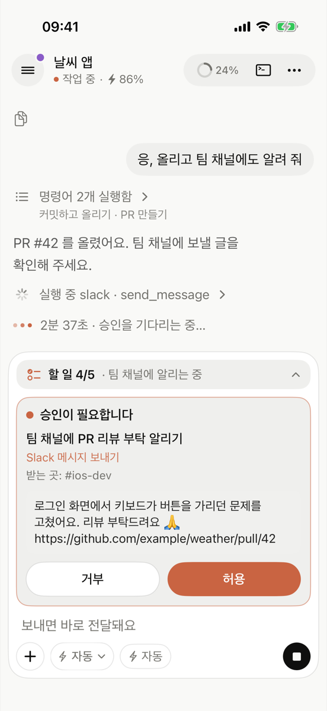
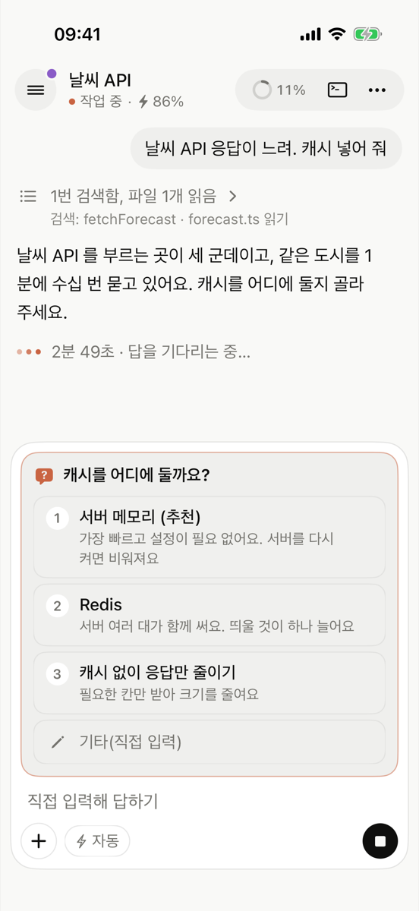
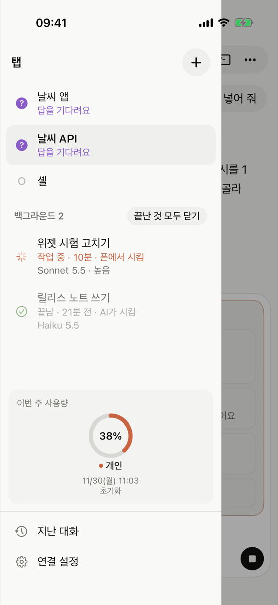
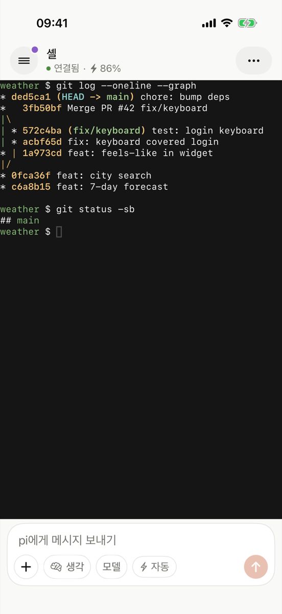

# Antenna

[한국어](./README.ko.md)

Use the [Claude Code](https://claude.com/claude-code) and [pi](https://www.npmjs.com/package/@earendil-works/pi-coding-agent) sessions running on your Mac from your iPhone.

<p align="center">
  
  
  
  
</p>
<p align="center"><sub>From left: a Claude Code tab (approval before sending), a pi tab (multiple-choice question), the tab drawer, the terminal view. The app's interface is in Korean; the conversations are examples.</sub></p>

Your agents keep running in tmux on the Mac. The iPhone app shows each tmux tab either as a chat (messages, approval and question cards, to-do list) or as the real terminal, and whatever you type on either side shows up on the other. Nothing runs on the phone. The app talks straight to a small bridge on your Mac, with no server in between. The only things that leave the Mac are the usage lookup (Anthropic) and, if you turn notifications on, the notifications (Apple's push service).

> Formerly called pi-remote. Identifiers still use the old name: the config folder `~/.config/pi-remote`, the `PI_REMOTE_*` settings, the `piremote://` link scheme.

## How I use it

- My MacBook keeps one tmux session running, with Claude Code and pi working in its tabs.
- When I step away from the Mac, I carry on from the iPhone app. Approvals and questions arrive as notifications and I answer them on the cards; long jobs go to background tabs.
- My home router runs a VPN server (OpenVPN). The MacBook stays connected to it even when I take it to the office or a café, and the phone joins the same VPN when I'm out, so the phone reaches the Mac at one VPN address from anywhere (see [Away from home](#away-from-home)).
- On the same Wi-Fi the phone connects directly, no VPN needed.

## What you get

- **Chat view** for Claude Code and pi tabs: the conversation, tool steps, and cards for permission prompts and multiple-choice questions that you can answer from the phone. Screens where Claude Code waits for a key without telling any hook (such as the unsent-feedback prompt on `/exit`) are read off the Mac screen and shown as cards too. While such a prompt is open on the Mac, a message you send from a Claude Code tab is not typed into it (it would land as an answer). Answer the card first, or send the message as "stop and send" to close the prompt and send it. When a Claude Code tab stops because it hit a limit for one model (for example the Fable limit) and switching accounts would not help, a card shows the exact date and time the limit resets (for each account that hit it) and offers the other models and a thinking-effort level: pick them and the tab switches to that model and effort for that session only (your default model is left alone) and continues the stopped request, or choose to wait.
- **Terminal view** for any tab: the same tmux window you see on the Mac.
- **Tabs**: switch, open, rename and close tmux windows; send a long task to a background tab (listed in its own section of the drawer with its status, elapsed time, the tab that asked for it, and its model and thinking level; finished ones close in one tap); reopen a past pi conversation. Shells and agents that Claude Code runs in the background show up under the tab as "백그라운드 작업 N" (background tasks); tap it to see each task's name, running time (for an agent also its type and model, and its thinking level when known) and the shell's latest output, and stop it (a shell is stopped right away; for an agent, Claude is asked to stop it). On the Mac, the tab that handed off the work shows the same in one "백그라운드: …" (background) line: a widget in pi, and in Claude Code a line that your own status line script can add from the tmux window option `@ai_bg_line` (that script is not part of this repository).
- **Instant tab switching**: the phone keeps each tab's conversation, so it shows the moment you tap, and the Mac sends only the messages the phone does not have yet (usually a few KB even for long tabs). Tabs that finish or ask something while you look elsewhere, and every tab when the app opens, get their new messages fetched in the background. Long conversations draw the latest messages first; tap "이전 대화 더 보기" (show earlier) at the top for more.
- **Image paths on the Mac** in an answer (written as inline code like `/Users/…/qr.png`, or without spaces) show as underlined links; tap one to fetch it from the Mac and view it full screen (zoom, save). The Mac re-encodes the image instead of sending the file itself, so files that are not images are never sent.
- **Admin (sudo) commands** open in their own tab where you confirm and type the password yourself; the agent never sees it.
- **Login passwords** (Claude Code): when you are away from the Mac and its Passwords app stays locked, Claude runs `claude-remote/password-run.mjs`, which opens its own tab (🔐암호) and pings your phone. Tap the masked field and pick the password from iPhone Passwords above the keyboard (Face ID). It lands on the Mac clipboard only briefly (this Mac only, marked so clipboard history skips it, cleared after 90 seconds), and Claude pastes it into the login field without ever seeing it.
- **Usage** of your Claude subscription limits (see the [note on usage](./docs/setup.md#usage)).
- **MacBook battery**: the Mac's charge shows next to the connection status at the top (a bolt when plugged in, red when under 20% without a charger). With notifications set up, the phone is also told once when it gets that low. Nothing is shown for a Mac without a battery.
- **Shortcuts**: a Shortcuts action, "맥의 AI 에게 일 시키기" (give the Mac's AI a task), starts Claude Code or pi on a task in a new background tab on the Mac without opening the app. Attach it to a Shortcuts automation (a time of day, arriving somewhere, plugging in the charger, an NFC tag) or run it from Siri or Spotlight (see [Shortcuts](./docs/setup.md#shortcuts)).
- **Notifications** when an agent needs you or finishes, with your own Apple push key (see [Notifications](./docs/setup.md#notifications)).
- After a reboot the bridge restores your tabs and resumes the conversations that were open.

The app's interface, the command-line messages and the code comments are in Korean. The guides are in English and Korean.

## How it works

```
 iPhone app  ── WebSocket (token) ──▶  bridge on the Mac  ──▶  tmux session
 (SwiftUI + SwiftTerm)                 (Node, port 8787)        ├─ Claude Code tab ⇄ hooks + feed (claude-remote/)
                                                                ├─ pi tab          ⇄ extensions   (pi-extension/)
                                                                └─ shell tab
```

- `server/` — the bridge. Attaches to your tmux session and relays the terminal, tab list, chat feed and cards over one WebSocket.
- `claude-remote/` — connects Claude Code tabs: hooks installed into `~/.claude/settings.json` plus a small feed process per tab.
- `pi-extension/` — connects pi tabs: extensions for the chat feed, approval and question cards, to-do list, plan mode.
- `ios/` — the app (SwiftUI, [SwiftTerm](https://github.com/migueldeicaza/SwiftTerm)). The Xcode project is generated with XcodeGen.
- `deploy/` — install helpers, the pairing QR, the health check, optional background jobs.

On the same Wi-Fi the phone finds the Mac by itself (Bonjour). Away from it, the phone connects to an address you give it, such as your Mac's Tailscale or VPN address.

## Requirements

- A Mac with [tmux](https://github.com/tmux/tmux) and [Node.js](https://nodejs.org) 20 or newer (`brew install tmux node`). It has to stay awake while you use it from the phone: when the Mac sleeps, the bridge stops
- Claude Code and/or pi on that Mac
- An iPhone or iPad on iOS 16 or newer
- To build the app: Xcode, [XcodeGen](https://github.com/yonaskolb/XcodeGen) (`brew install xcodegen`), and a paid Apple Developer Program membership

## Quick start

**1. Install the Mac side**

```sh
git clone <this repository> antenna   # <this repository>: the address from the Code button on this page
cd antenna
sh install.sh
```

`install.sh` checks tmux and Node, installs the bridge's modules, creates the settings file `~/.config/pi-remote/env`, hooks up Claude Code and pi if you have them, starts the bridge at login, and runs a health check. It is safe to run again. It does not install tmux or Node for you, and it does not touch anything optional.

Clone the repository somewhere it can stay (under your home folder, for example). The login item that starts the bridge holds the path of this folder, so if you move the folder, run `sh install.sh` again.

On a Mac with pi, the pi extensions the phone needs are installed into `~/.pi/agent/extensions/`, and pi changes accordingly. It gets a feed that sends the conversation to the phone and tools for multiple-choice questions, a to-do list, plan mode, artifacts and background tabs, and it asks for approval before sending a message to someone or running a command that is hard to undo (in a pi that runs without a screen, those actions are blocked). A file with the same name that is already there with different contents is kept in `~/.cache/pi-remote/backup/` and replaced.

**2. Put the app on your phone**

Each person builds the app and installs it. You need a paid Apple Developer account (the app uses the push notification entitlement, which a free account can't sign).

```sh
cp ios/Local.xcconfig.example ios/Local.xcconfig   # put your Apple team ID and your own identifier prefix in it
(cd ios && xcodegen generate && open PiRemote.xcodeproj)
```

Select your phone and run. Details and a command-line install are in the [setup guide](./docs/setup.md#building-the-app).

**3. Pair**

```sh
sh deploy/pair.sh
```

A QR code appears in the terminal. Scan it with the phone's camera (or with "QR 코드 찍기" on the app's first screen). It carries a one-time pairing code, the fingerprint of your Mac's certificate, the port and your Mac's address, so there is nothing to type. The phone trades the code for a token of its own. The QR goes away when the phone is paired, when you press Enter, or after five minutes.

The first time the app opens, iOS asks about local network access. Allow it, or the app cannot find the Mac on the same Wi-Fi. If scanning with the camera is what opened the app for the first time, it may say "맥에 닿지 못했어요" (could not reach the Mac) while you are answering that prompt; scan once more while the QR is still up. If it still says so, check that the phone and the Mac are on the same Wi-Fi.

**4. Work**

```sh
tmux attach -t antenna
```

Start `claude` or `pi` inside that session. The tab shows up in the app. To leave tmux while the session keeps running, press Ctrl-b and then d (with the default tmux settings).

When a new version is out, run `git pull` and then `sh install.sh` again on the Mac, and get the new build of the app on the phone (see [Updating](./docs/setup.md#updating)).

## Away from home

By default the phone only finds the Mac on the same Wi-Fi. To use it from anywhere, **a VPN is recommended**: put both devices on a private network (VPN) and tell Antenna the Mac's address on it. Do not forward the bridge's port on your router to the internet.

```sh
sh install.sh --host 100.64.0.1    # your Mac's Tailscale / VPN IP address, comma-separated for several
sh deploy/pair.sh                  # scan again so the phone learns the address
```

Any network that gives the Mac an address the phone can reach will do (Tailscale, WireGuard, OpenVPN). If this is new to you, a VPN service like Tailscale is the easiest; if your router has a VPN server built in, that works too. I use the OpenVPN server on my home router every day, with both the MacBook and the phone connected to it.

How to choose a network, and the steps for each way (a VPN service that links your devices, the VPN server on your home router, a company VPN), are in the [setup guide](./docs/setup.md#reaching-the-mac-from-outside).

## Security

- Each phone gets its own token when it pairs. The phone keeps it in the keychain; the Mac keeps only a hash of it.
- The QR holds a one-time code that expires after five minutes, so a photo of it is useless afterwards.
- `sh deploy/pair.sh --list` shows the paired devices and `sh deploy/pair.sh --revoke <id>` cuts one off, including a connection that is open.
- The connection is encrypted (TLS). Each Mac makes its own certificate; the QR carries its fingerprint and the app talks only to the Mac with that fingerprint, so another device on the same network cannot listen in or pose as your Mac.
- Anyone holding a device's token can type into your terminal. If a phone is lost, revoke it.
- Even so, do not forward the bridge's port to the internet. Reach it over your own Wi-Fi or a private network.

## Optional features

All off unless you turn them on. See the [setup guide](./docs/setup.md#optional-features).

- Notifications through your own Apple push key (see [Notifications](./docs/setup.md#notifications))
- Two Claude accounts chosen by folder, switching when one hits its limit
- Keeping the Mac connected to an OpenVPN server
- Daily updates of Claude Code and pi, restarting idle sessions on a new version
- Opening a terminal attached to the session at login
- Extra pi extensions (compact tool display, web search, sub-agents)

## Check and test

```sh
node deploy/doctor.mjs         # is everything installed and running? (settings, bridge, hooks, installed copies)
node deploy/doctor.mjs --fix   # fix what can be fixed safely
sh test.sh                     # the test suite: no model calls, never touches your real session or bridge (needs Node 22.6 or newer)
sh test/readme-shots.sh        # retake the app screenshots above in the Simulator (example conversations, needs Xcode)
```

If the bridge ever dies, the reason is kept in `~/.cache/pi-remote/crash.log` and the health check shows it.

## Status

A personal tool that grew up; expect rough edges.

- macOS and iOS only.
- The author uses it daily on macOS 26 with tmux 3.5a (Homebrew), Claude Code 2.1 and pi 1.5. Older versions have not been tested.
- Parts of a Claude Code tab (the number of background tasks, the cards read off the screen, whether it is working) depend on what Claude Code draws in the terminal. When a new version of Claude Code changes its screen, they can be off until this is updated.
- There is no prebuilt app to share. Everyone builds and signs it themselves, and builds it again for a new release.
- Notifications need your own Apple developer push key (see [Notifications](./docs/setup.md#notifications)).

## License

[Apache License 2.0](./LICENSE). See [NOTICE](./NOTICE).

Author: 서문교
